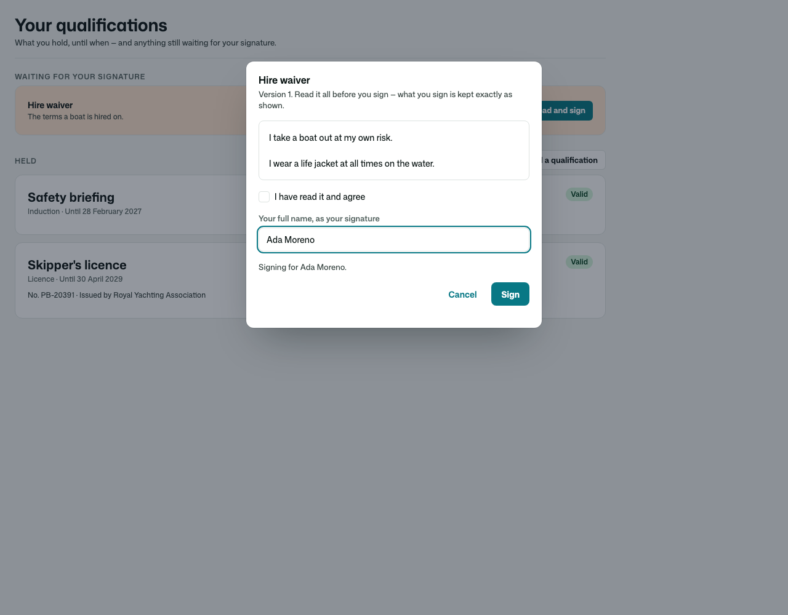
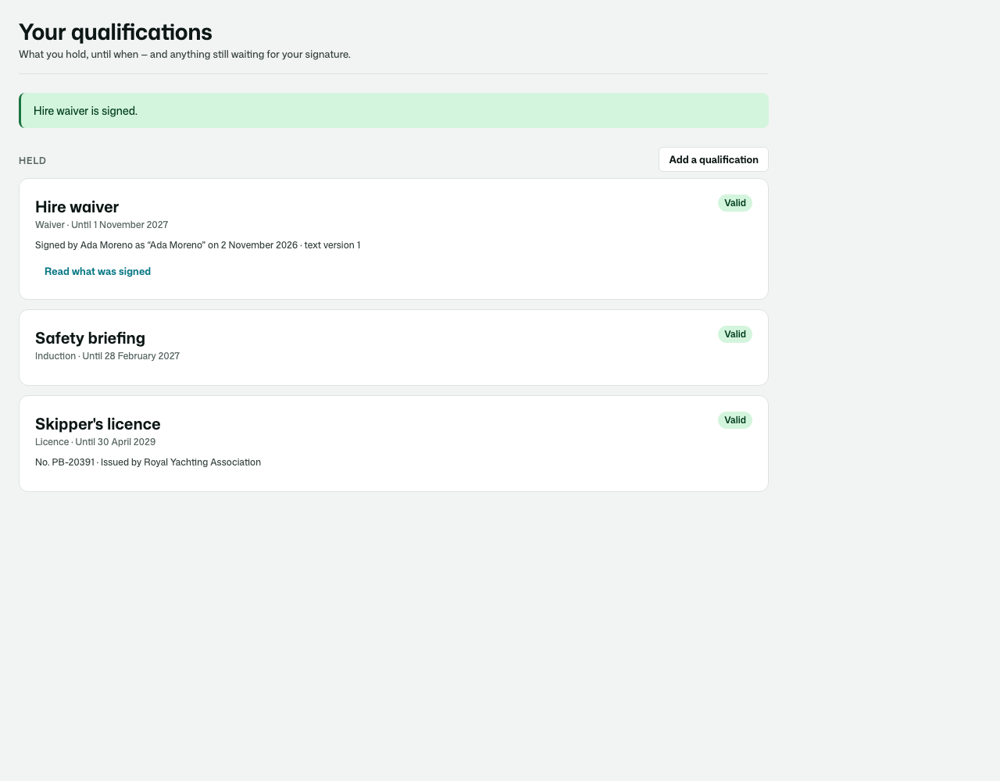
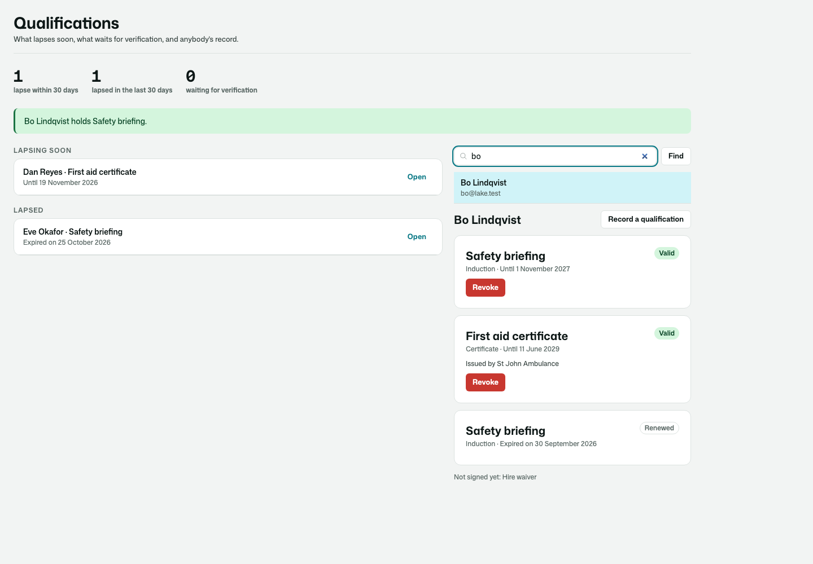
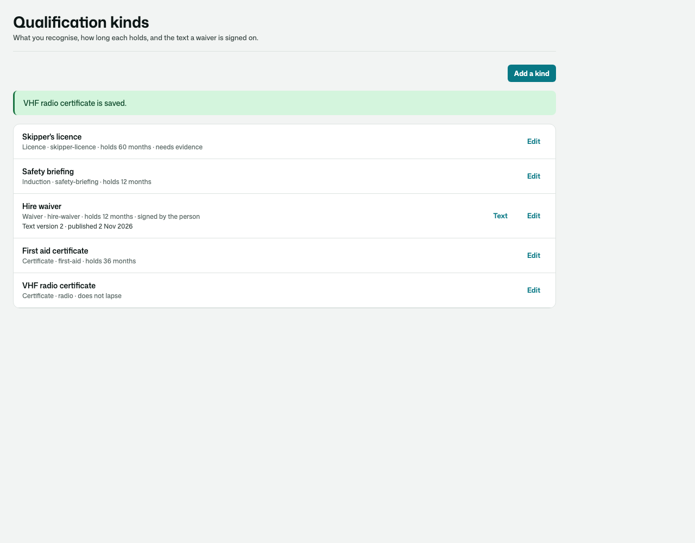
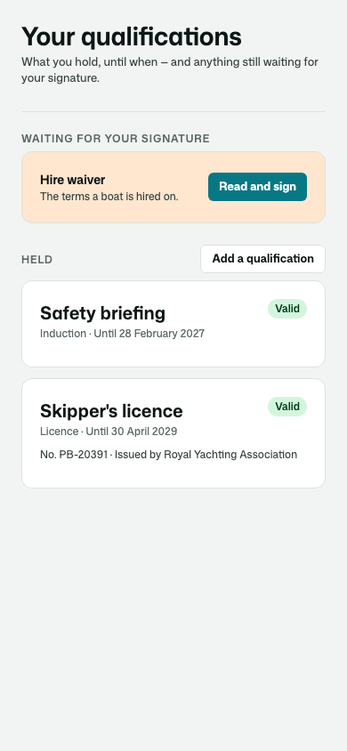
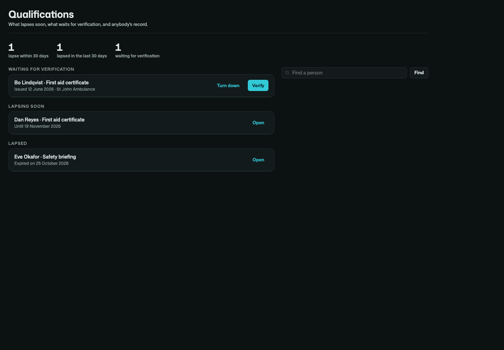

# Osysharp.Qualifications

**What a person holds that lets them do something** — a licence, a certificate, an induction, a background check, a
signed waiver. For boat and equipment hire, workshops, clinics, venues, contractors on site, volunteers. (Not sign-in:
that is Osysharp.UserAccounts.)

- **Kinds** you recognise, each valid for a number of months — or not lapsing at all — with its own notice period.
- **Recorded by staff**, **signed by the person** (or a parent for a child who never signs in), or **submitted with
  evidence** — a scan or a photo — and counted once staff **verify** it, or turned down with the reason.
- **A waiver signed on the exact text shown**: each wording is a version, nobody signs one they were not shown, and the
  signature keeps the version, the name typed and who signed.
- **One call that answers** whether somebody holds it on a day — and when not, why not: *Hire waiver has not been
  signed.* · *Skipper's licence expired on 30 September 2026.* · *First aid certificate was revoked: the number did not
  check out.* `QualificationGap(person, ["induction", "waiver"])` blocks anything that needs them.
- **A notice before each lapses** and word when it does — silent for one renewed in time.
- **Revocation** with the reason; nothing is edited away or deleted.

| Signing a waiver | What a person holds |
|---|---|
|  |  |

| The desk | The kinds |
|---|---|
|  |  |

| On a phone · in the dark |
|---|
|   |

## Use it

```osy
// app.osy
use Osysharp.Identity@0;
use Osysharp.Qualifications@0;
use Osysharp.Storage;
```

```osy
using Osysharp.Identity;
using Osysharp.Qualifications;

policy IssuesQualifications => IsStaff;          // record, verify, revoke; read everybody's
policy ManagesQualificationKinds => IsAdmin;     // the kinds, and what a waiver says
policy ActsForHolder(Principal holder) => holder == user || IsParentOf(holder);   // sign for a child

app.Qualifications = new QualificationsSetup { RenewalNoticeDays = 30 };

// Wherever a qualification matters:
var why = QualificationGap(person, ["site-induction", "activity-waiver"]);
if (why != "") { throw new ValidationException(why); }

[On] void AskToRenew(QualificationExpiringSoon e) { /* tell e.Qualification.Holder */ }
```

From code: `RecordQualification`, `SignQualification(holder, text, name)`, `SubmitQualification`, `KeepEvidence(upload)`,
`AttachEvidence`, `VerifyQualification`, `RejectQualification`, `RevokeQualification`, `PublishQualificationText`, `CheckQualification`,
`HasValidQualification`, `MissingQualifications`, `QualificationGap`, `QualificationsOf`, `LapsingWithin(days)`, `LapsedWithin(days)`,
`AwaitingVerification`, `StillToSign(holder)`. Events: `QualificationRecorded`, `QualificationSubmitted`, `QualificationRejected`,
`QualificationRevoked`, `QualificationExpiringSoon`, `QualificationExpired`. With Osysharp.ShiftScheduling, a rota position's
requirements are answered by these qualifications (`Osysharp.ShiftScheduling.Qualifications` arrives by itself).

## Pages

`/qualifications` (the signed-in person), `/staff/qualifications` (the desk) and `/staff/qualifications/kinds` are served in the
app's working shell, in its theme. Take one over by declaring a component of the same name, or place
`QualificationsOfPerson(person)` — a parent's page signing for a child — `QualificationsDesk` or `QualificationKinds` on a page of
your own.

## Personal data

The number on a qualification, the typed signature and why one was revoked are classified personal content. In an app with
Osysharp.Privacy, Osysharp.Privacy.Qualifications arrives by itself: a person's qualifications — with the exact text they
signed — and their files are in their copy of their data and are erased when they ask.

## What informed it

- **Waiver platforms (Smeetz, Argenta, VolunteerHub)** — a waiver valid for a number of months, each signature stamped
  with its own expiry; an adult signing for a minor; a changed setting touching only what is signed from then on.
- **Deputy** — training a person must hold before a shift is offered or swapped to them.
- **Qualification tracking in healthcare and contracting** — evidence submitted and verified by a reviewer, reminders
  before a licence lapses, and a list of what lapses soon.

## Source

[github.com/osysharp/qualifications](https://github.com/osysharp/qualifications). Its tests (`tests/`) are a boat hire's: every
behaviour above, each seam shown, and the pages under `osy test --pixels`.
